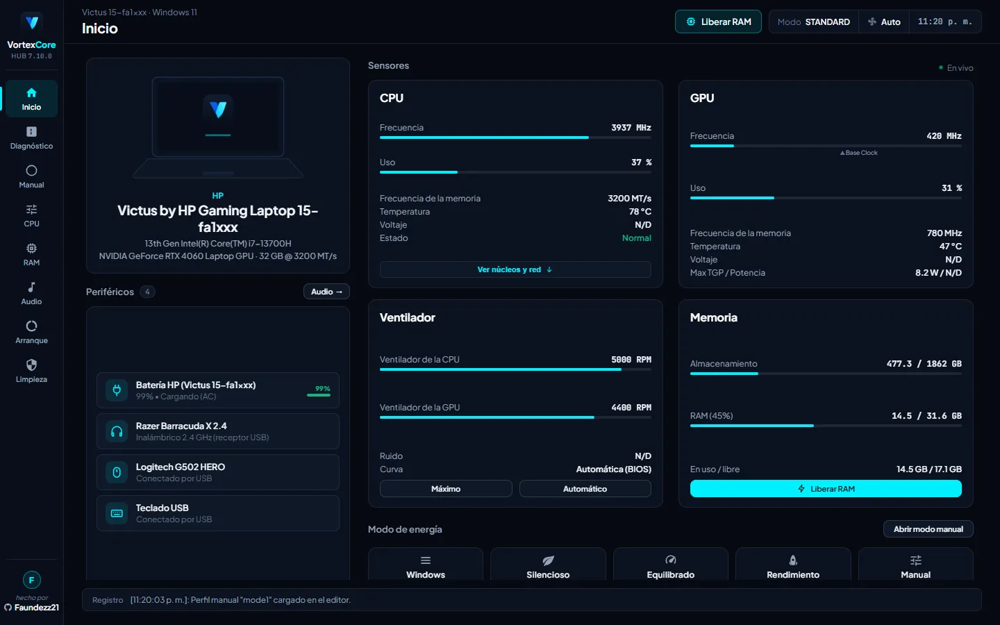

# VortexCore Hub

[](https://www.microsoft.com/windows)
[](https://github.com/Faundezz21/Vortex_Core/releases/latest)
[](LICENSE)

Centro de control y telemetría de hardware para Windows 10/11, pensado como alternativa ligera a suites pesadas de fabricantes (*OMEN Gaming Hub*, *Armoury Crate*, *Lenovo Vantage*).

**Desarrollado por [Faundezz21](https://github.com/Faundezz21)**

---

<p align="center">
  
</p>

## Motivación y enfoque

Muchos programas de control térmico instalan drivers kernel vulnerables (como `WinRing0.sys`) que Windows 11 bloquea por *Aislamiento de Núcleo (HVCI)*, consumen cientos de megabytes en segundo plano o rellenan tarjetas con valores estimados cuando falta un sensor.

VortexCore Hub sigue dos reglas simples:

1. **Solo datos reales:** si Windows o el firmware no exponen un sensor (por ejemplo, RPM fuera de portátiles HP o métricas GPU sin NVIDIA), la interfaz muestra `N/D` en lugar de inventar números.
2. **Compatible con Windows 11 moderno (HVCI):** utiliza APIs estándar de Windows (PDH, WMI, Registry, `powercfg`, Win32) y soporta el controlador firmado **PawnIO** para temperaturas individuales por núcleo sin recurrir a `WinRing0.sys`.

---

## Qué incluye

- **Hub gaming (overlay dentro del juego):** HUD integrado al juego con FPS reales (PresentMon), 1% low, temperaturas, uso y consumo de CPU y GPU, VRAM, RAM, ventiladores, ping y batería. Aparece solo mientras juegas, cambia de tema según el juego (PUBG, Rocket League, CS2, Minecraft, Valorant y más), solo se colorea cuando algo está mal y se muestra u oculta con un atajo configurable.
- **Red por app y ping al juego:** qué programas usan internet y a qué velocidad (ETW del kernel de Windows), y ping, variación y pérdida al servidor del juego, con medición aproximada cuando el servidor bloquea el ping.
- **Actualizaciones con un clic:** revisa los releases de GitHub, avisa en la bandeja y dentro de la app, y con **Actualizar ahora** descarga, verifica el SHA-256 e instala la versión nueva sola.
- **Diagnóstico de ventiladores:** registro de lo que responde la BIOS e informe para guardar en el Escritorio o reportar en GitHub cuando un modelo no se lee.
- **Inicio y telemetría en tiempo real:** frecuencia efectiva de CPU, uso por núcleo e hilo lógico, GPU NVIDIA (`nvidia-smi`), RAM física instalada y velocidad en MT/s, almacenamiento y radar de periféricos (batería Bluetooth y mandos XInput).
- **Temperaturas por núcleo y red en vivo:**
  - Lectura nativa de núcleos físicos (`P-Cores` / `E-Cores`) mediante `LibreHardwareMonitorLib` + **PawnIO**, además de lectura directa en memoria compartida de **Core Temp** o **HWiNFO** y zonas térmicas ACPI reales.
  - Monitor de red en tiempo real (descarga/subida, totales, IPv4, enlace y ping) e **Intensificador de Red** con medidor real de *jitter*/pérdida, selector de DNS más rápido (Cloudflare, Google, AdGuard, Quad9 o DHCP), desactivación de `NetworkThrottlingIndex`, TCP Auto-Tuning normal y ahorro Wi-Fi en rendimiento máximo.
- **Control térmico y perfiles de energía:** modos *Windows*, *Silencioso*, *Equilibrado*, *Rendimiento* y *Manual*. Control WMI nativo en **HP Victus / OMEN** (`hpqBIntM`), **Acer Nitro / Predator** (`AcerGamingFunction`), **Lenovo Legion / LOQ** (`LENOVO_GAMEZONE_DATA`), **ASUS ROG / TUF** (`AsusAtkWmi_WMNB`) y **Dell / Alienware** (`AWCCWmiMethodFunction`), además de cambio de **Windows Power Overlay (Modern Standby)** para **todos los notebooks** (MSI, Huawei, Samsung, LG, Gigabyte, Razer, ThinkPad, ZenBook, etc.).
- **Diagnóstico y salud de batería:** índice de salud en vivo, recomendaciones accionables y lectura real de capacidad de fábrica vs. carga completa (`mWh`), nivel de desgaste y ciclos desde ACPI WMI y `powercfg`.
- **Optimización y mantenimiento:**
  - Liberación de memoria en espera (*Standby RAM* vía Win32) y listado de procesos con mayor consumo de RAM.
  - Limpiador real de espacio: escanea y elimina temporales de usuario/Windows y caché de sombreadores (DirectX, NVIDIA y AMD) recalculando los MB recuperados.
  - Gestor nativo de programas de inicio (`StartupApproved`) y desinstalación segura de apps preinstaladas (manteniendo protegido a Microsoft Edge).
- **Audio y ecualización:** mezclador de volumen por aplicación (Windows CoreAudio) y ecualizador de 10 bandas con sincronización hacia Equalizer APO.

---

## Compatibilidad por fabricante

| Equipo | Ventiladores / Perfiles OEM | CPU, Turbo y Power Overlay | GPU (NVIDIA / AMD / Intel) | RAM, Batería, Red, Audio y Limpieza |
| :--- | :---: | :---: | :---: | :---: |
| **HP Victus / OMEN** | Nativo (`hpqBIntM` WMI + RPM) | Sí (Windows 10/11) | Sí (`nvidia-smi` + WDDM/LHM) | Sí |
| **Acer Nitro / Predator** | Nativo (`AcerGamingFunction` WMI + RPM) | Sí (Windows 10/11) | Sí (`nvidia-smi` + WDDM/LHM) | Sí |
| **Lenovo Legion / LOQ** | Nativo (`LENOVO_GAMEZONE_DATA` WMI) | Sí (Windows 10/11) | Sí (`nvidia-smi` + WDDM/LHM) | Sí |
| **ASUS ROG / TUF** | Nativo (`AsusAtkWmi_WMNB` WMI + RPM) | Sí (Windows 10/11) | Sí (`nvidia-smi` + WDDM/LHM) | Sí |
| **Dell / Alienware** | Nativo (`AWCCWmiMethodFunction` WMI) | Sí (Windows 10/11) | Sí (`nvidia-smi` + WDDM/LHM) | Sí |
| **MSI / Huawei / Samsung / LG / Gigabyte / Otros** | Modo Universal (BIOS automático) | Sí (`Power Overlay` + `powercfg`) | Sí (WDDM PDH + PawnIO/LHM) | Sí |

---

## Instalación

### Usuarios (sin Python)

Desde la página de **[Releases](https://github.com/Faundezz21/Vortex_Core/releases/latest)**:

- **`Vortex-core-hub-Setup.exe`**: instalador oficial para Windows con accesos directos y desinstalador.
- **`VortexCoreHub-v7.12.0-Portable.zip`**: versión portátil lista para descomprimir y ejecutar `VortexCoreHub.exe`.

> **SmartScreen:** al no contar con un certificado comercial de firma de código, Windows Defender SmartScreen puede mostrar un aviso la primera vez (*Más información → Ejecutar de todas formas*). Todo el código fuente y los hashes SHA-256 de cada release son públicos en este repositorio.

### Desarrollo local

Requisitos: Windows 10/11 (64 bits) y Python 3.10+.

```powershell
# Instalar dependencias
pip install -r requirements.txt

# Iniciar el servidor local y la ventana de la app
python vortex_engine.py
```

Para ejecutar las pruebas unitarias:

```powershell
python -m unittest discover -s tests -v
```

Para generar el ejecutable con PyInstaller y el paquete portable / instalador:

```powershell
pip install -r requirements-build.txt
python build_installer.py
```

---

## Arquitectura del proyecto

```text
├── vortex_engine.py               # Backend HTTP local (127.0.0.1:8765), control de energía y ventana Edge/WebView2
├── hw_sensors.py                  # Lectores reales (PDH, WMI, PnP, batería ACPI, SHM CoreTemp/HWiNFO, PawnIO)
├── tray_manager.py                # Bandeja del sistema, notificaciones e inicio automático por tarea programada
├── game_overlay.py                # HUD dentro del juego (ventana Win32 con GDI+ y transparencia por píxel)
├── fps_monitor.py                 # FPS por proceso leyendo PresentMon y detección de juegos
├── net_monitor.py                 # Consumo de red por app (ETW) y ping al servidor del juego
├── updater.py                     # Aviso de nuevas versiones desde los releases de GitHub
├── hp_fan_controller.ps1          # Comunicación WMI BIOS para equipos HP (opcodes 0x27, 0x2D, 0x23, 0x1A)
├── vortex-hub/                    # Interfaz web local (HTML, CSS y JS vanilla sin frameworks)
├── tests/                         # Pruebas unitarias (seguridad HTTP, sensores, parsers y consistencia de versión)
├── .github/workflows/             # CI/CD: pruebas, compilación PyInstaller, Inno Setup y publicación de releases
├── build_installer.py / installer.iss / vortex_core_hub.spec
├── VERSION / CHANGELOG.md / LICENSE
```

### Decisiones técnicas destacables

- **Seguridad en API local:** aunque el servidor escucha en `127.0.0.1:8765`, rechaza peticiones con `Origin`, `Host` o cabeceras `Sec-Fetch-Site` externas (protección contra CSRF y DNS rebinding) y valida los rangos de todos los parámetros recibidos.
- **Instancia única y bandeja del sistema:** si la aplicación ya está abierta, un segundo lanzamiento enfoca la ventana existente; al minimizar o cerrar la ventana permanece activa en la bandeja junto al reloj.
- **Versionado centralizado:** el archivo [`VERSION`](VERSION) actúa como fuente única de verdad para el build, la caché del frontend (`?v=...`) y el workflow de GitHub Actions.

---

## Licencia y autoría

Distribuido bajo licencia **MIT** ([LICENSE](LICENSE)).

**Desarrollado por [Faundezz21](https://github.com/Faundezz21)**
