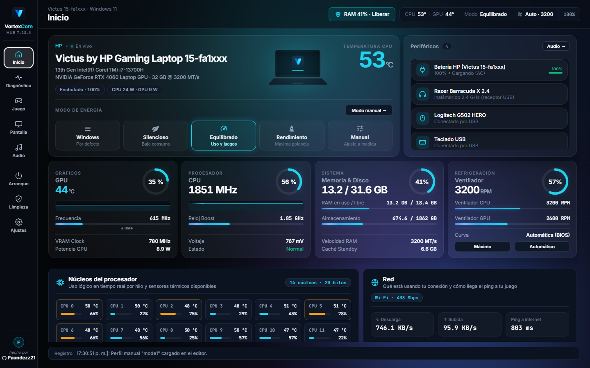
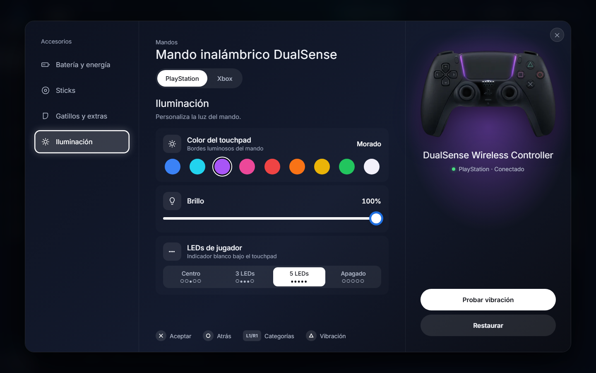
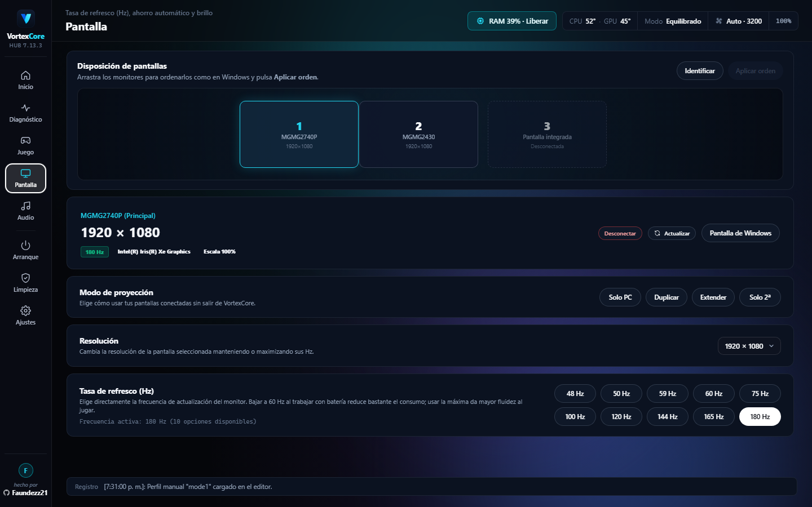

<p align="center">
  
</p>

<h1 align="center">VortexCore Hub</h1>

<p align="center">
  <a href="https://www.microsoft.com/windows"></a>
  <a href="https://github.com/Faundezz21/Vortex_Core/releases/latest"></a>
  <a href="LICENSE"></a>
</p>

<p align="center">
  Centro de control, estudio de mandos y telemetría de hardware para Windows 10/11 con estética de consola <b>PlayStation 5</b>, pensado como alternativa ligera a suites pesadas de fabricantes (<i>OMEN Gaming Hub</i>, <i>Armoury Crate</i>, <i>Lenovo Vantage</i>) y utilidades de terceros (<i>DS4Windows</i>, <i>EarTrumpet</i>).
</p>

<p align="center">
  <b>Desarrollado por <a href="https://github.com/Faundezz21">Faundezz21</a></b>
</p>

---

## Capturas de pantalla

### Panel principal (Estilo de consola PS5 + Telemetría Bento en vivo)
<p align="center">
  
</p>

### Estudio interactivo del mando (DualSense PS5 y Xbox)
<p align="center">
  
</p>

### Control nativo de Pantalla, Tasas de Refresco (Hz) y Brillo
<p align="center">
  
</p>

---

## Motivación y enfoque

Muchos programas de control térmico instalan drivers kernel vulnerables (como `WinRing0.sys`) que Windows 11 bloquea por *Aislamiento de Núcleo (HVCI)*, consumen cientos de megabytes en segundo plano o rellenan tarjetas con valores estimados cuando falta un sensor.

VortexCore Hub sigue dos reglas simples:

1. **Solo datos reales:** si Windows o el firmware no exponen un sensor (por ejemplo, RPM fuera de portátiles soportados o métricas GPU sin sensor disponible), la interfaz muestra `N/D` en lugar de inventar números.
2. **Compatible con Windows 11 moderno (HVCI):** utiliza APIs estándar de Windows (PDH, WMI, Registry, `powercfg`, Win32, HID, CoreAudio) y soporta el controlador firmado **PawnIO** para temperaturas individuales por núcleo sin recurrir a `WinRing0.sys`.

---

## Qué incluye

- **Estudio del mando PS5 (DualSense) y Xbox + Puente ViGEm (`dualsense_bridge.py`):**
  - **Interfaz y navegación de consola:** ventana inspirada en la configuración nativa de PlayStation 5 y Xbox con 4 categorías (**Batería y energía**, **Sticks**, **Gatillos y extras** e **Iluminación**), navegable al 100 % con el propio mando (**D-Pad / Stick**, `✕` aceptar, `○` atrás, `L1`/`R1` categorías y `△` prueba de vibración) o teclado.
  - **Vista fotorrealista en vivo a 60 FPS:** ilumina sobre el mando cada botón presionado, muestra el desplazamiento real de los sticks analógicos, inclina el mando en 3D y sincroniza el porcentaje real de batería del DualSense por Bluetooth y USB.
  - **Iluminación física RGB y LEDs de jugador:** personaliza el color de los bordes luminosos del touchpad, el nivel de brillo y los **5 LEDs blancos centrales de jugador** (`○○●○○`, `○●●●○`, `●●●●●` o apagados) tanto por Bluetooth (`0x31`) como por USB (`0x02`).
  - **Emulación y ajustes competitivos:** conversión en tiempo real a mando **Xbox 360 (XInput)** o **DualShock 4** mediante ViGEm, con zona muerta anti-drift, curvas de respuesta (*Lineal*, *Precisión*, *Rápida*), inversión del eje Y, gatillos rápidos (*hair-trigger*), touchpad como ratón, micrófono, ahorro de energía y apagado por inactividad.
- **Control nativo de Pantalla y Tasas de Refresco (`display_manager.py`):**
  - Detecta todas las tasas reales del monitor (48 / 60 / 120 / 144 / 165 / 180 / 240 Hz) para cambiar en 1 clic desde la pestaña **Pantalla** o desde el menú de la bandeja.
  - **Cambio automático Cargador / Batería:** permite elegir qué tasa de refresco aplicar automáticamente al enchufar el equipo (p. ej. 144 Hz) y cuál al pasar a batería (p. ej. 60 Hz para ahorrar energía), además de controlar el brillo del panel integrado.
- **Mezclador de audio por aplicación y selector estilo EarTrumpet (`audio_devices.py`, `audio_flyout.py`):**
  - Cambia al instante el dispositivo de salida o entrada predeterminado de Windows (altavoces, audífonos inalámbricos, monitores HDMI/DisplayPort o micrófonos) desde la pestaña **Audio** o desde el menú de la bandeja.
  - Ajusta o silencia el volumen individual de cada aplicación abierta en tiempo real (Windows CoreAudio) e incluye ecualizador de 10 bandas con sincronización hacia Equalizer APO.
- **Bandeja del sistema con temperatura en vivo y menú oscuro (`tray_manager.py`, `tray_menu.py`):**
  - Muestra los grados de la CPU en tiempo real directamente en el icono junto al reloj con código de color térmico (cian, ámbar o rojo) y tooltip con CPU/GPU.
  - Menú contextual oscuro estilo Windows 11 con cambio rápido de perfil térmico, tasa de refresco (Hz), salida de audio, liberación de RAM y alertas de batería baja.
- **Hub gaming (overlay dentro del juego, `game_overlay.py`):**
  - HUD integrado al juego con FPS reales (PresentMon), 1% low, temperaturas, uso y consumo de CPU y GPU, VRAM, RAM, ventiladores, ping y baterías de periféricos.
  - Aparece solo mientras juegas, cambia de tema según el juego (PUBG, Rocket League, CS2, Minecraft, Valorant y más), solo se colorea cuando algo supera un umbral térmico y se muestra u oculta con un atajo configurable (acepta teclas solas como `F8` o `Insert`).
- **Red por app, ping al servidor del juego e Intensificador (`net_monitor.py`):**
  - Muestra qué programas usan internet y a qué velocidad leyendo eventos ETW del kernel de Windows, y mide ping, variación (*jitter*) y pérdida al servidor real de la partida (con medición aproximada `≈` cuando el datacenter bloquea ICMP).
  - **Intensificador de Red:** benchmark paralelo de DNS (Cloudflare, Google, AdGuard, Quad9), desactivación de `NetworkThrottlingIndex`, TCP Auto-Tuning normal y energía Wi-Fi en máximo rendimiento.
- **Control térmico multi-marca y modo juego automático:**
  - Pasa automáticamente a **Rendimiento** al detectar un juego en primer plano y restaura el modo anterior al cerrarlo.
  - Control WMI nativo en **HP Victus / OMEN** (`hpqBIntM`), **Acer Nitro / Predator** (`AcerGamingFunction`), **Lenovo Legion / LOQ** (`LENOVO_GAMEZONE_DATA`), **ASUS ROG / TUF** (`AsusAtkWmi_WMNB`) y **Dell / Alienware** (`AWCCWmiMethodFunction`), además de **Windows Power Overlay (Modern Standby)** para todos los notebooks y lectura de marca/modelo directo desde el firmware SMBIOS.
- **Diagnóstico, batería, limpieza y actualizaciones en 1 clic:**
  - Índice de salud del sistema, desgaste y capacidad real de batería (`mWh`), informe de diagnóstico de ventiladores para guardar o reportar en GitHub, liberación de *Standby RAM*, limpiador de caché de sombreadores (DirectX / NVIDIA / AMD), gestor de arranque y botón **Actualizar ahora** con verificación SHA-256 e instalación silenciosa.

---

## Compatibilidad por fabricante

| Equipo | Ventiladores / Perfiles OEM | CPU, Turbo y Power Overlay | GPU (NVIDIA / AMD / Intel) | Pantalla (Hz), Audio, Mando PS5/Xbox, Red y Limpieza |
| :--- | :---: | :---: | :---: | :---: |
| **HP Victus / OMEN** | Nativo (`hpqBIntM` WMI + RPM) | Sí (Windows 10/11) | Sí (`nvidia-smi` + WDDM/LHM) | Sí |
| **Acer Nitro / Predator** | Nativo (`AcerGamingFunction` WMI + RPM) | Sí (Windows 10/11) | Sí (`nvidia-smi` + WDDM/LHM) | Sí |
| **Lenovo Legion / LOQ** | Nativo (`LENOVO_GAMEZONE_DATA` WMI) | Sí (Windows 10/11) | Sí (`nvidia-smi` + WDDM/LHM) | Sí |
| **ASUS ROG / TUF** | Nativo (`AsusAtkWmi_WMNB` WMI + RPM) | Sí (Windows 10/11) | Sí (`nvidia-smi` + WDDM/LHM) | Sí |
| **Dell / Alienware** | Nativo (`AWCCWmiMethodFunction` WMI) | Sí (Windows 10/11) | Sí (`nvidia-smi` + WDDM/LHM) | Sí |
| **MSI / Huawei / Samsung / LG / Gigabyte / Otros** | Modo Universal (BIOS automático) | Sí (`Power Overlay` + `powercfg`) | Sí (WDDM PDH + PawnIO/LHM) | Sí |

---

## Instalación

### Usuarios (sin Python)

Desde la página de **[Releases](https://github.com/Faundezz21/Vortex_Core/releases/latest)**:

- **`Vortex-core-hub-Setup.exe`**: instalador oficial para Windows con accesos directos, ícono renovado y desinstalador.
- **`VortexCoreHub-v7.13.3-Portable.zip`**: versión portátil lista para descomprimir y ejecutar `VortexCoreHub.exe`.

> **SmartScreen:** al no contar con un certificado comercial de firma de código, Windows Defender SmartScreen puede mostrar un aviso la primera vez (*Más información → Ejecutar de todas formas*). Todo el código fuente y los hashes SHA-256 de cada release son públicos en este repositorio.

### Desarrollo local

Requisitos: Windows 10/11 (64 bits) y Python 3.10+.

```powershell
# Instalar dependencias
pip install -r requirements.txt

# Iniciar el servidor local y la ventana de la app
python vortex_engine.py
```

Para ejecutar las pruebas unitarias:

```powershell
python -m unittest discover -s tests -v
```

Para generar el ejecutable con PyInstaller y el paquete portable / instalador:

```powershell
pip install -r requirements-build.txt
python build_installer.py
```

---

## Arquitectura del proyecto

```text
├── vortex_engine.py               # Backend HTTP local (127.0.0.1:8765), energía, audio, pantalla y ventana Edge/WebView2
├── hw_sensors.py                  # Sensores reales (PDH, WMI, SMBIOS, PnP, batería ACPI, Razer/DualSense HID, PawnIO)
├── dualsense_bridge.py            # Puente nativo DualSense -> Xbox 360/DS4 (ViGEm), LEDs RGB, 5 LEDs de jugador y vibración
├── display_manager.py             # Control nativo de tasas de refresco (Hz), cambio automático AC/Batería y brillo WMI
├── audio_devices.py               # Enumeración y cambio de dispositivos de audio predeterminados (IPolicyConfig COM)
├── audio_flyout.py                # Selector flotante nativo de salida de audio y volumen estilo EarTrumpet
├── tray_manager.py                # Bandeja del sistema, icono dinámico con temperatura de CPU y alertas de batería
├── tray_menu.py                   # Menú contextual oscuro estilo Windows 11 para la bandeja del sistema
├── game_overlay.py                # HUD dentro del juego (ventana Win32 con GDI+ y transparencia por píxel)
├── fps_monitor.py                 # FPS por proceso leyendo PresentMon y detección automática de juegos
├── net_monitor.py                 # Consumo de red por app (ETW) y ping real/aproximado al servidor del juego
├── updater.py                     # Detección e instalación verificada (SHA-256) de nuevas versiones desde GitHub
├── hp_fan_controller.ps1          # Comunicación WMI BIOS para equipos HP (opcodes 0x27, 0x2D, 0x23, 0x1A)
├── oem_fan_controller.ps1         # Comunicación WMI BIOS para Acer, Lenovo, ASUS y Dell/Alienware
├── vortex-hub/                    # Interfaz web local con estética de consola PS5 (HTML, CSS, JS y assets DualSense/Xbox)
├── tests/                         # Suite de 124 pruebas unitarias (seguridad HTTP, sensores, mando, pantalla, HUD y versión)
├── .github/workflows/             # CI/CD: pruebas, compilación PyInstaller, Inno Setup y publicación de releases
├── build_installer.py / installer.iss / vortex_core_hub.spec
├── VERSION / CHANGELOG.md / LICENSE
```

### Decisiones técnicas destacables

- **Seguridad en API local:** aunque el servidor escucha en `127.0.0.1:8765`, rechaza peticiones con `Origin`, `Host` o cabeceras `Sec-Fetch-Site` externas (protección contra CSRF y DNS rebinding) y valida los rangos de todos los parámetros recibidos.
- **Instancia única y bandeja del sistema:** si la aplicación ya está abierta, un segundo lanzamiento enfoca la ventana existente; al minimizar o cerrar la ventana permanece activa en la bandeja junto al reloj.
- **Versionado centralizado:** el archivo [`VERSION`](VERSION) actúa como fuente única de verdad para el build, la caché del frontend (`?v=...`) y el workflow de GitHub Actions.

---

## Licencia y autoría

Distribuido bajo licencia **MIT** ([LICENSE](LICENSE)).

**Desarrollado por [Faundezz21](https://github.com/Faundezz21)**
